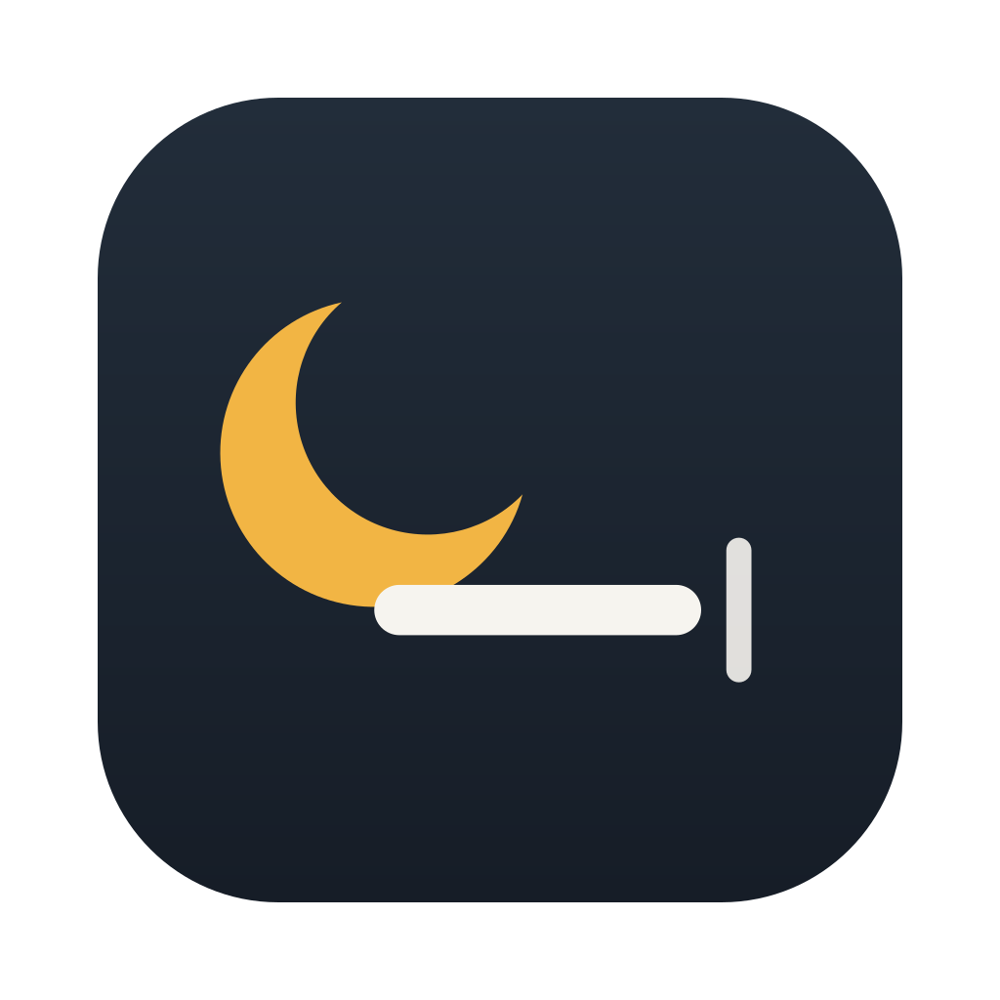
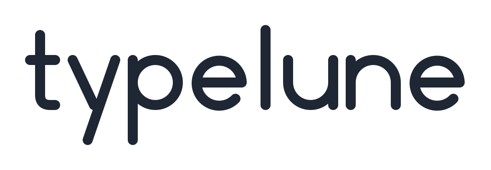

<p align="center">
  
</p>
<p align="center">
  
</p>

Typelune is a small native text expander for macOS. You type a short abbreviation, and
Typelune replaces it with the full text: a signature, an address, today's date or a
template.

> **Developer preview.** Builds are ad-hoc signed and **not notarized** by Apple, so macOS
> will warn you before opening one. Building from source is the recommended way to try it.

[Download the developer preview](https://github.com/tranxuanliem/typelune/releases) · [Build status](https://github.com/tranxuanliem/typelune/actions/workflows/ci.yml)

## Features

- **Native Mac app.**
  - Built with SwiftUI.
  - A three-column window: groups, a searchable snippet list, and an editor with a live
    preview.
  - Standard menus, keyboard shortcuts and Settings, plus light and dark appearance.
- **Careful matching.**
  - Expands after a delimiter (space, punctuation, Return) or immediately.
  - Word-boundary aware, and the longest match wins.
  - Each snippet can be case-sensitive.
  - Unicode-safe, including Vietnamese and other composed text.
- **Placeholders:** `{{date}}`, `{{time}}`, `{{date:%A, %d %B}}`, `{{clipboard}}`,
  `{{cursor}}`.
- **Playground.** Try your snippets in a scratch area without enabling anything
  system-wide.
- **System-wide expansion, off by default.** You turn it on yourself (or opt in to starting
  it when Typelune opens). It needs the Accessibility permission, which you grant in System
  Settings. See [docs/privacy.md](docs/privacy.md).
- **Menu bar.** Typelune keeps running in the menu bar after you close its window, with
  Start/Pause/Resume, Quick Search, Open Library and Quit. Optional launch at login.
- **Quick Search.** A global shortcut (default ⌃⌥⌘T) opens a small panel that searches
  titles, abbreviations, text and tags. Return types the snippet into the field you came
  from (after re-checking it); ⌘Return copies it.
- **App exclusions.** Pick apps in which Typelune never records typing, expands or inserts.
- **Backups.** A daily backup before the first change of the day, *Backup Now*, preview and
  restore with Undo; the newest 30 are kept.
- **Your data stays local.** One JSON file in Application Support, with JSON import/export,
  CSV import with a preview ([docs/import.md](docs/import.md)), and merge or replace with
  Undo.

## Requirements

- macOS 15 or later, on Apple Silicon.
- To build: Rust (stable), Python 3.11 or later, and either Xcode or the Command Line
  Tools. The Command Line Tools need a macOS 26.x SDK; see
  [docs/architecture.md](docs/architecture.md#toolchain).

## Build and run

```bash
scripts/test-all.sh      # format, lint, Rust and Swift tests, identity checks
scripts/build-app.sh     # builds dist/Typelune.app (ad-hoc signed, not notarized)
open dist/Typelune.app
```

To try it with a throwaway library: `open -n --env TYPELUNE_DATA_DIR=/tmp/typelune-try dist/Typelune.app`.
(Environment variables set before a plain `open` are not passed on by Launch Services.)

## Upgrading from the earlier prototype

Versions before 0.3.0 were an internal prototype with a different name. On first launch,
Typelune **copies** that prototype's library into its own folder, byte for byte. It never
moves or changes the original, and never overwrites an existing Typelune library. If the
old file is unreadable or invalid, Typelune copies nothing, shows the reason, and keeps
saving disabled.

## Documentation

- [Architecture](docs/architecture.md)
- [Privacy and permissions](docs/privacy.md)
- [Importing snippets (CSV)](docs/import.md)
- [Brand](docs/brand.md)
- [Testing](docs/testing.md)
- [Releasing](docs/releasing.md)
- [Contributing](CONTRIBUTING.md)
- [Security](SECURITY.md)
- [Changelog](CHANGELOG.md)

## License

[MIT](LICENSE). Licenses of bundled third-party Rust dependencies are in
[THIRD_PARTY_NOTICES.txt](THIRD_PARTY_NOTICES.txt), which also ships inside the app
(`Typelune.app/Contents/Resources/`). Typelune is an independent project. It is not affiliated with any other
text-expansion product.
